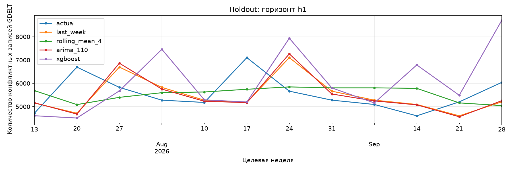

# Недельный прогноз конфликтной активности: Израиль

Решение тестового задания Forecast DS. Выбран вариант A: регрессия количества конфликтных записей GDELT на горизонтах 1, 2, 3 и 4 недели
Израиль выбран из-за высокой активности в данных и заметных изменений уровня ряда. Это позволяет сравнить простые прогнозы со статистической моделью и бустингом на разных временных отрезках.

## Целевая переменная

Для каждой недели понедельник-воскресенье:

```text
y(t) = число строк gdelt-bq.gdeltv2.events,
       где ActionGeo_CountryCode = 'IS',
       EventRootCode входит в ('18', '19'),
       а дата SQLDATE относится к неделе t.

target_h1(t) = y(t + 1 неделя)
target_h2(t) = y(t + 2 недели)
target_h3(t) = y(t + 3 недели)
target_h4(t) = y(t + 4 недели)
```

Коды 18 и 19 соответствуют Assault и Fight.

Прогноз выпускается после завершения недели `t`, когда её наблюдения уже известны. Последующие фактические значения при построении прогноза не используются.

## Данные и источники

| Источник | Версия / локальная копия | Дата скачивания | Использование |
|---|---|---|---|
| [GDELT, данные и BigQuery](https://gdeltproject.org/data.html) | GDELT 2.0 Events, таблица `gdelt-bq.gdeltv2.events`; недельная выгрузка `data/raw/gdelt.csv` | 09.10.2026 | Цель, объём записей, тональность и Goldstein |
| [ACLED, описание агрегированных данных](https://acleddata.com/use-access/how-use-acleds-aggregated-data) | `Middle-East_aggregated_data_up_to_week_of-2026-09-26.xlsx`, локальное имя `data/raw/acled.xlsx` | 09.10.2026 | Дополнительные исторические признаки |

Для ACLED может требоваться регистрация; в работе используется агрегированный Excel, а не API с отдельными событиями. Наблюдения GDELT охватывают **157 непрерывных недель: 02.10.2023-28.09.2026** по датам начала недели. Последняя полная неделя заканчивается 04.10.2026

### Объединение ACLED и GDELT

Скрипт `src/data/prepare_acled.py` выбирает Израиль, суммирует Battles и Explosions/Remote violence по неделям ACLED и присоединяет их к GDELT

ACLED использует недели суббота-пятница. Сдвиг ключа `week_start = acled_week_start + 9 дней` складывается из двух дней календарного выравнивания и дополнительной недели лага. Это допущение о доступности сводки; фактические исторические даты публикации неизвестны

## Структура и запуск

```text
src/
  data/prepare_acled.py          # объединение локальных источников
  eda.ipynb                     # EDA и подготовка признаков / таргетов
  modeling.ipynb                # CV, подбор, holdout, будущий прогноз
data/
  raw/
    acled.xlsx
    gdelt.csv                     # исходные локальные файлы
  processed/
    israel_weekly_merged.csv
    israel_model_dataset.csv
outputs/
  metrics.json                  # итоговые метрики holdout
  forecast.csv                  # прогноз четырёх следующих недель
  figures/holdout_h1.png ... holdout_h4.png
requirements.txt
```

Нужен установленный Python 3.11 и редактор с поддержкой Jupyter

Из корня проекта в PowerShell:

```powershell
python -m venv .venv
.\.venv\Scripts\python.exe -m pip install -r requirements.txt
```

Далее:

1. Открыть `src/eda.ipynb`, выбрать ядро созданной `.venv`, выполнить ячейки сверху вниз. Ноутбук читает объединённый недельный ряд и сохраняет модельную таблицу.
2. Открыть `src/modeling.ipynb` с тем же ядром и выполнить ячейки сверху вниз. Полный запуск включает подбор 36 конфигураций XGBoost и 5184 обучения в самом подборе, поэтому этот этап занимает основную часть времени.
3. Проверить `outputs/metrics.json`, `outputs/forecast.csv` и четыре графика. Сохранённые результаты также можно посмотреть в ноутбуке без повторного расчёта.

Исходные копии `acled.xlsx` и `gdelt.csv` находятся в `data/raw`

## Признаки и модели

Признаки вычисляются по текущей завершённой неделе и прошлому:

- текущее количество конфликтных записей и лаги 1, 2, 4, 12;
- среднее за 4 недели, стандартное отклонение за 12, максимум за 8, сумма за 12 и недельное изменение;
- общий объём записей GDELT, его недельное изменение и доля конфликтных записей;
- тональность и статистики Goldstein;
- три присоединённых признака ACLED;
- месяц, закодированный отдельными индикаторами.

Первые 12 недель не имеют полного набора лагов и исключаются. Итоговая таблица содержит 145 строк, 32 признака, дату и четыре таргета: всего 37 столбцов. Неизвестные будущие таргеты в конце ряда остаются пустыми; для обучения строки отбираются отдельно для каждого горизонта.

Сравниваются четыре подхода:

| Модель | Логика |
|---|---|
| `last_week` | Повторить последнее известное значение для любого горизонта |
| `rolling_mean_4` | Повторить среднее четырёх последних известных недель |
| `arima_110` | ARIMA(1,1,0), прогноз до нужного горизонта |
| `xgboost` | Отдельная direct-модель для каждого h1-h4 |

Для бустинга прогноз h2 не использует предсказанный h1. Масштабирование признаков не применяется. ARIMA выбрана как компактный статистический ориентир; сравнение с ETS и Prophet в этой работе не проводилось.

## Валидация

Последние 12 целевых недель, **13.07.2026-28.09.2026**, выделены в holdout. Случайного разбиения нет.

Для CV используются три последовательных отрезка по 12 целевых недель:

| Отрезок | Первая целевая неделя | Последняя целевая неделя |
|---|---|---|
| 1 | 13.10.2025 | 29.12.2025 |
| 2 | 05.01.2026 | 23.03.2026 |
| 3 | 30.03.2026 | 15.06.2026 |

Последний ответ для подбора датирован 15.06.2026
На holdout параметры не подбираются и его ответы не включаются в обучение XGBoost

Основной критерий подбора - средний MASE по 12 сочетаниям «отрезок × горизонт». Дополнительно считаются sMAPE и RMSE. Масштаб MASE - среднее абсолютное недельное изменение ряда по истории до первого origin данного отрезка и горизонта

## Результаты

Средние метрики CV по трём отрезкам и четырём горизонтам:

| Модель | MASE | sMAPE, % | RMSE |
|---|---:|---:|---:|
| last_week | **0,871** | **23,658** | **3188,321** |
| ARIMA(1,1,0) | 0,880 | 23,844 | 3215,861 |
| rolling_mean_4 | 1,046 | 29,079 | 3640,647 |
| XGBoost, исходный | 1,222 | 35,636 | 3781,639 |
| XGBoost, после подбора | 1,172 | 34,255 | 3839,571 |

Лучшие параметры XGBoost по среднему CV MASE: `n_estimators=400`, `max_depth=6`, `learning_rate=0.02`, `min_child_weight=5`, `reg_lambda=1`. Остальные настройки: `objective="reg:squarederror"`, `tree_method="hist"`, `random_state=42`, `n_jobs=2`.

Итоговые метрики holdout, среднее по четырём горизонтам:

| Модель | MASE | sMAPE, % | RMSE | Снижение среднего MASE относительно last_week |
|---|---:|---:|---:|---:|
| last_week | 0,374 | 15,325 | 1097,302 | 0% |
| rolling_mean_4 | **0,341** | **13,701** | **1079,336** | +8,87% |
| ARIMA(1,1,0) | 0,378 | 15,438 | 1131,518 | -1,04% |
| XGBoost, после подбора | 0,706 | 26,035 | 2149,025 | -88,73% |

Меньше MASE, sMAPE и RMSE - лучше. Последняя колонка рассчитана как `100 × (1 - mean_MASE_model / mean_MASE_last_week)`; в `metrics.json` сравнение сохранено отдельно для каждого горизонта. RMSE в таблицах - среднее отдельных RMSE, а не RMSE по объединённым ошибкам.

На holdout скользящее среднее лучше по среднему качеству и MASE на h1-h3. Для финального прогноза сохранён `last_week`, выбранный по CV

### Будущий прогноз

После последней полной недели 28.09-04.10.2026 прогнозируются недели с началом 05.10, 12.10, 19.10 и 26.10.2026. Это прогноз относительно конца данных, а не относительно даты запуска ноутбука. Для всех четырёх горизонтов `last_week` даёт **6041** запись.

В `outputs/forecast.csv` сохранены столбцы `country, forecast_week, horizon, target_type, predicted_value, predicted_prob, ci_lower, ci_upper, model`. `forecast_week` записан как дата понедельника



Остальные графики: [h2](outputs/figures/holdout_h2.png), [h3](outputs/figures/holdout_h3.png), [h4](outputs/figures/holdout_h4.png).

## Три главных вывода

1. Последний известный уровень оказался сильным ориентиром: `last_week` лидирует в среднем на CV, а ARIMA даёт близкое качество. На финальном отрезке полезным оказалось сглаживание четырёх недель.
2. XGBoost с текущими признаками уступает простым подходам. Подбор уменьшил CV MASE с 1,222 до 1,172, но не устранил отставание. Небольшая выборка, смена режима и ошибки на всплесках - возможные причины; их вклад отдельно не проверялся.
3. При дальнейшем развитии полезнее проверять новые данные и представление цели на временной валидации, чем расширять тот же перебор параметров. Усложнение модели само по себе не гарантирует улучшения.

## Ограничения и дальнейшая работа

- GDELT отражает освещение в новостях и автоматическую классификацию. Объём записей может меняться из-за медиаповестки, покрытия источников, дублей и ошибок извлечения, а не только из-за реальной активности.
- `SQLDATE` не доказывает, что каждая запись была доступна в реальном времени. Исторические задержки поступления и пересмотры данных не восстановлены. Аналогичное ограничение действует для ACLED; его лаг принят как допущение.

При большем количестве времени я бы проверил следующие гипотезы:

- Получать признаки из текстов новостей с помощью BERT. Например, собирать эмбеддинги опубликованных за неделю новостей и добавлять их в бустинг вместе с текущими признаками. Для этого нужны сами тексты и время их публикации: в текущих недельных таблицах их нет.
- Продолжить эксперименты с бустингом: попробовать другие лаги и скользящие окна, прогноз изменения относительно последней недели и разную длину обучающей истории. Это помогло бы проверить, насколько результат зависит от признаков и постановки задачи, а не только от гиперпараметров.
